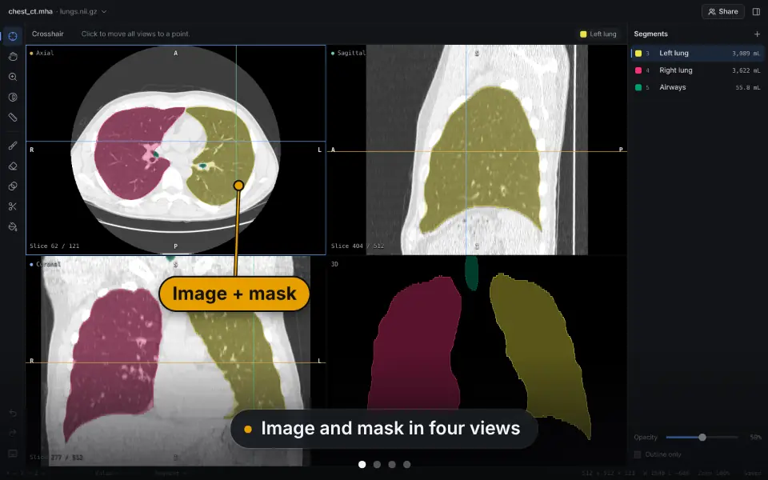

<div align="center">


<h1>W Annotator</h1>

A desktop app for macOS, Windows and Linux that opens 3D medical images and lets you view and correct segmentation masks, alone or with other people in the same mask at once.

<p>
  <a href="https://github.com/ArioMoniri/w-annotator/releases/latest/download/W-Annotator-macOS.dmg"></a>
  <a href="https://github.com/ArioMoniri/w-annotator/releases/latest/download/W-Annotator-Windows-setup.exe"></a>
  <a href="https://github.com/ArioMoniri/w-annotator/releases/latest/download/W-Annotator-Linux.AppImage"></a>
</p>

<sub>Other formats (.msi, .deb, .rpm) and older versions are on the <a href="https://github.com/ArioMoniri/w-annotator/releases">releases page</a>.<br>
macOS builds are signed and notarised. The app updates itself from GitHub Releases.</sub>

<br><br>

<a href="docs/assets/launch.mp4"></a>

<sub><a href="docs/assets/launch.mp4">Watch the 30-second tour</a></sub>

</div>

## What it does

W Annotator shows a volume in axial, sagittal and coronal views with a 3D view of the mask, and lets you fix the mask by hand. The image and the mask can be in different formats; a mask on another grid is resampled to the image.

<p align="center">
  
</p>

<p align="center"><sub>A chest CT with a lung mask: two people in one mask, fill between slices, refining a segment, the four views, and the two themes.</sub></p>

- Editing tools: brush and eraser (circle or sphere, size in mm), threshold brush, scissors and fill. Painting can go over everything, only empty voxels, or only inside one segment.
- Scissors: rectangle, circle, freehand loop or sphere; erase inside, erase outside or fill inside; on this slice or through all slices.
- Fill tool: fill an enclosed area, or click a stray piece of a segment to remove it, or the real one to keep it.
- Alt-click the image to select the segment under the cursor.
- Fill between slices: paint every few slices, look at the preview of the gaps being filled, then apply it.
- Smooth pixels on or off for the slice views, to see exactly which voxels a mask covers.
- Segments: add, rename, recolour, hide, lock, clear and delete. Each row shows the volume in mL.
- Segment operations: grow, shrink, smooth, fill holes, keep the largest island, remove small islands, split islands into separate segments, and combine with another segment.
- Viewing: crosshair, pan, zoom, a ruler, window/level with CT presets, mask opacity and an outline-only view.
- Layouts: 2×2, one large view with three beside it, three across, two across or a single view. Any pane can show any view, and lines link the planes.
- Files: a list of the open image and up to four masks. One mask is edited; the others show as outlines for comparison.
- Mouse and trackpad: two-finger scroll moves through slices, pinch zooms about the pointer, and the settings let you change both.
- Autosave keeps a recovery copy of unsaved edits and offers it back after a crash.
- Undo and redo, a light, dark or system theme, and a form that turns a problem report into a GitHub issue.

## File formats

<p align="center">
  
</p>

Drop files onto the window, use *Open with* from the system file manager (an image and its mask can be selected together), or open them from the menu. Opens NIfTI (`.nii`, `.nii.gz`), MetaImage (`.mha`, `.mhd`), NRRD (`.nrrd`, `.seg.nrrd`), DICOM series (uncompressed, RLE, JPEG, JPEG-LS, JPEG 2000 and HTJ2K) and DICOM SEG. Saves masks as `.nii.gz`, `.nii`, `.mha`, `.nrrd` or DICOM SEG (`.dcm`).

## Working together

A room lets several people edit one mask at the same time. Nobody needs an account, only a display name (kept in Settings).

1. Open an image, press **Share** and choose the kind of room.
2. Send each person an invite link. A link works for one person and stops working after 24 hours; make another from the room menu.
3. They paste it under *Join a room*.

There are two kinds of room, chosen when it is started:

| | Shared copy | View through my computer |
|---|---|---|
| What others receive | The image and the mask. They keep a copy. | 8-bit pictures of the slices they look at, and the labels on them. Never the files. |
| Without the host | They keep working. Offline work is merged when they come back; where both sides changed the same voxels the room's version stays and theirs waits for *Use mine* or *Keep the room's*. | The room ends when the host leaves. Guests are disconnected and what was in memory is cleared. |
| Saving | Everyone can save. | Only the host. Guests cannot save and no recovery copy is written. |

The host can remove a person, switch off a link that has not been used, and end or delete the room. Removing someone from a shared-copy room does not delete the copy they already have.

Things to know before sharing:

- View through my computer limits what leaves the host's computer. It cannot stop someone photographing or recording their screen, and a guest who visits every slice has seen an 8-bit version of the whole image.
- Voxel data can identify a person by itself (a face in a head scan, text burned into the pixels). De-identify an image before sharing it. The app never sends file names or DICOM tags, but it cannot check pixels.
- What a room sends is encrypted between the apps with a key carried in the invite link. Whoever runs the room server sees addresses, times, sizes and who is in which room, not names, voxels or segment names.
- W Annotator is not for diagnosis or treatment.

With the server field left empty, the desktop app hosts the room itself. That works for people on the same network or VPN, and the room stops when the host closes the app. To work over the internet, or to keep a shared-copy room open while the host is away, run the relay in [`relay/`](relay/README.md) (a small Rust server, with a Dockerfile) and enter its address when starting the room. The relay forwards messages, keeps who is in a room in memory and stores nothing on disk. The design is in [`docs/design/ROOMS.md`](docs/design/ROOMS.md).

## Shortcuts

| Key | Action | Key | Action |
| --- | --- | --- | --- |
| `B` / `E` | Brush / eraser | `C` | Crosshair |
| `T` | Threshold brush | `H` / `Z` | Pan / zoom |
| `S` / `F` | Scissors / fill | `W` | Window / level |
| `[` `]` | Brush size | `R` | Ruler |
| `I` | Fill between slices | `Space` | Last tool |
| `N` | New segment | `1`–`9` | Select segment |
| `O` | Outline only | `X` | Hide or show the mask |
| `↑` `↓` | Previous / next slice | `M` | Maximise or restore a view |
| `Ctrl+1`–`5` | Choose a layout | `Ctrl+,` | Settings |
| `Ctrl+Z` | Undo | `Ctrl+Shift+Z` | Redo |
| `Ctrl+O` | Open image | `Ctrl+Shift+O` | Open mask |
| `Ctrl+S` | Save mask | `?` | All shortcuts |

On macOS use `Cmd` in place of `Ctrl`. Scroll changes slice (`Shift` for five at a time), `Ctrl`+scroll or a pinch zooms, middle-drag pans, right-drag changes window/level and `Alt`-click (`Option`-click on macOS) selects the segment under the cursor. A trackpad scrolls through slices in proportion to how far your fingers move; Settings → Mouse and trackpad has the direction, speed and what a two-finger scroll does. Press `?` in the app to see every shortcut and change any of them.

## Build from source

You need Node with pnpm, Rust, and the [Tauri v2 prerequisites](https://v2.tauri.app/start/prerequisites/) for your system.

```
pnpm install
pnpm tauri dev           # run the desktop app
pnpm test                # unit tests
pnpm e2e                 # end-to-end tests
cargo test --workspace   # Rust tests, app and relay
```

## Releasing

Pushing a `v*` tag builds the installers and a draft release. The steps and the signing secrets are in [docs/RELEASING.md](docs/RELEASING.md).

## Built on

- [Cornerstone3D](https://www.cornerstonejs.org/), the rendering engine and tool library of the [OHIF Viewer](https://ohif.org/).
- [Tauri](https://tauri.app/) for the desktop shell and the updater.

The logo and file-format animations are Lottie files (`.json` in [`docs/assets`](docs/assets)). The tour is composed with [Remotion](https://www.remotion.dev/) from a recording of the app; its source is in [`video/`](video/README.md).

## Licence

[PolyForm Noncommercial 1.0.0](LICENSE). W Annotator is free for non-commercial use. Commercial use needs permission from Ariorad Moniri.

The scan in the screenshots and the tour is from [LUNA16](https://luna16.grand-challenge.org), a subset of [LIDC-IDRI](https://www.cancerimagingarchive.net/collection/lidc-idri/), shown with the LUNA16 lung mask. Both are licensed [CC BY 4.0](https://creativecommons.org/licenses/by/4.0/).

W Annotator is not a medical device and must not be used for diagnosis or treatment.
