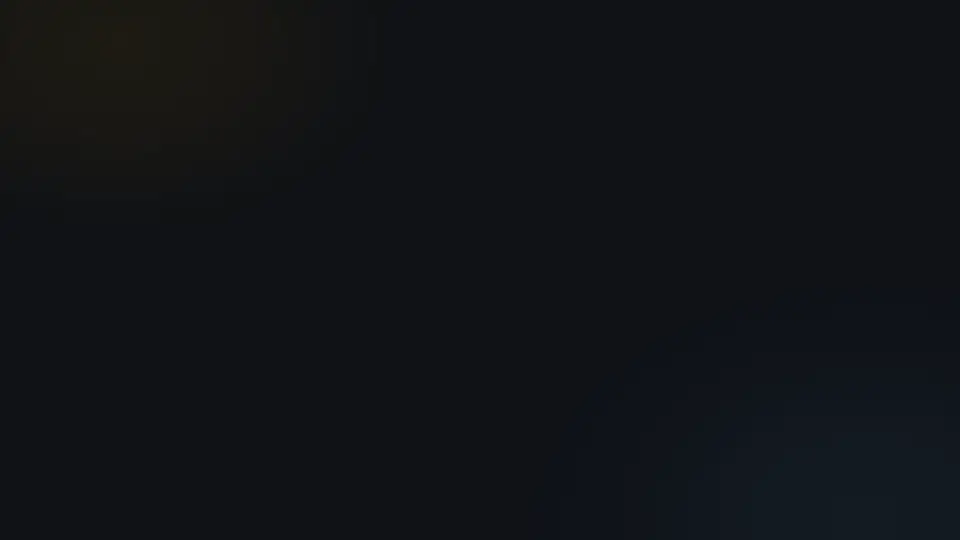

<div align="center">


<h1>W Annotator</h1>

A desktop app for macOS, Windows and Linux that opens 3D medical images and lets you view and correct segmentation masks, alone or with other people in the same mask at once.

<p>
  <a href="https://github.com/ArioMoniri/w-annotator/releases/latest"></a>
  <a href="https://github.com/ArioMoniri/w-annotator/releases/latest"></a>
  <a href="https://github.com/ArioMoniri/w-annotator/releases/latest"></a>
</p>

<sub>macOS builds are signed and notarised. The app updates itself from GitHub Releases.</sub>

<br><br>

<a href="docs/assets/launch.mp4"></a>

<sub><a href="docs/assets/launch.mp4">Watch the 30-second tour</a></sub>

</div>

## What it does

W Annotator shows a volume in axial, sagittal and coronal views with a 3D view of the mask, and lets you fix the mask by hand. The image and the mask can be in different formats; a mask on another grid is resampled to the image.

<table>
  <tr>
    <td width="50%"></td>
    <td width="50%"></td>
  </tr>
  <tr>
    <td align="center"><sub>Opening an MHA image with a <code>.nii.gz</code> mask over it.</sub></td>
    <td align="center"><sub>Correcting a lung edge with the brush. Shift-drag erases.</sub></td>
  </tr>
  <tr>
    <td></td>
    <td></td>
  </tr>
  <tr>
    <td align="center"><sub>Painting bone only, with the threshold brush set to a value range.</sub></td>
    <td align="center"><sub>Renaming, combining or refining a segment from its menu.</sub></td>
  </tr>
  <tr>
    <td></td>
    <td></td>
  </tr>
  <tr>
    <td align="center"><sub>Editing with a second person, whose cursor shows on the slice.</sub></td>
    <td align="center"><sub>Changing a keyboard shortcut in the shortcuts sheet.</sub></td>
  </tr>
</table>

- Editing tools: brush and eraser (circle or sphere, size in mm), threshold brush, scissors and fill. The brush can paint over everything or only empty voxels.
- Fill between slices: paint every few slices and the app fills the gaps.
- Segments: add, rename, recolour, hide, lock, clear and delete. Each row shows the volume in mL.
- Segment operations: grow, shrink, smooth, fill holes, keep the largest island, remove small islands, and combine with another segment.
- Viewing: crosshair, pan, zoom, a ruler, window/level with CT presets, mask opacity and an outline-only view.
- Undo and redo, a light, dark or system theme, and a form that turns a problem report into a GitHub issue.

## File formats

<p align="center">
  
</p>

Opens NIfTI (`.nii`, `.nii.gz`), MetaImage (`.mha`, `.mhd`), NRRD (`.nrrd`, `.seg.nrrd`), DICOM series (uncompressed, RLE, JPEG, JPEG-LS, JPEG 2000 and HTJ2K) and DICOM SEG. Saves masks as `.nii.gz`, `.nii`, `.mha`, `.nrrd` or DICOM SEG (`.dcm`).

## Working together

A room lets several people edit one mask at the same time. Nobody needs an account, only a display name.

1. Open an image, press **Share** and start a room.
2. Send the invite link to the others.
3. They paste it under *Join a room* and type a name.
4. Someone who joins with nothing open receives the image and the mask.

With the server field left empty, the desktop app hosts the room itself. That works for people on the same network or VPN. To work over the internet, run the relay in [`relay/`](relay/README.md) (a small Rust server, with a Dockerfile) and enter its address when starting the room. The relay forwards messages and stores nothing.

## Shortcuts

| Key | Action | Key | Action |
| --- | --- | --- | --- |
| `B` / `E` | Brush / eraser | `C` | Crosshair |
| `T` | Threshold brush | `H` / `Z` | Pan / zoom |
| `S` / `F` | Scissors / fill | `W` | Window / level |
| `[` `]` | Brush size | `R` | Ruler |
| `I` | Fill between slices | `Space` | Last tool |
| `N` | New segment | `1`–`9` | Select segment |
| `O` | Outline only | `X` | Hide or show the mask |
| `↑` `↓` | Previous / next slice | `M` | Maximise or restore a view |
| `Ctrl+Z` | Undo | `Ctrl+Shift+Z` | Redo |
| `Ctrl+O` | Open image | `Ctrl+Shift+O` | Open mask |
| `Ctrl+S` | Save mask | `?` | All shortcuts |

On macOS use `Cmd` in place of `Ctrl`. Scroll changes slice, `Ctrl`+scroll zooms, middle-drag pans and right-drag changes window/level. Press `?` in the app to see every shortcut and change any of them.

## Build from source

You need Node with pnpm, Rust, and the [Tauri v2 prerequisites](https://v2.tauri.app/start/prerequisites/) for your system.

```
pnpm install
pnpm tauri dev           # run the desktop app
pnpm test                # unit tests
pnpm e2e                 # end-to-end tests
cargo test --workspace   # Rust tests, app and relay
```

## Releasing

Pushing a `v*` tag builds the installers and a draft release. The steps and the signing secrets are in [docs/RELEASING.md](docs/RELEASING.md).

## Built on

- [Cornerstone3D](https://www.cornerstonejs.org/), the rendering engine and tool library of the [OHIF Viewer](https://ohif.org/).
- [Tauri](https://tauri.app/) for the desktop shell and the updater.

The logo and file-format animations are Lottie files (`.json` in [`docs/assets`](docs/assets)). The tour is composed with [Remotion](https://www.remotion.dev/) from a recording of the app; its source is in [`video/`](video/README.md).

## Licence

[PolyForm Noncommercial 1.0.0](LICENSE). W Annotator is free for non-commercial use. Commercial use needs permission from Ariorad Moniri.

The scan in the screenshots and the tour is from [LUNA16](https://luna16.grand-challenge.org), a subset of [LIDC-IDRI](https://www.cancerimagingarchive.net/collection/lidc-idri/), shown with the LUNA16 lung mask. Both are licensed [CC BY 4.0](https://creativecommons.org/licenses/by/4.0/).

W Annotator is not a medical device and must not be used for diagnosis or treatment.
