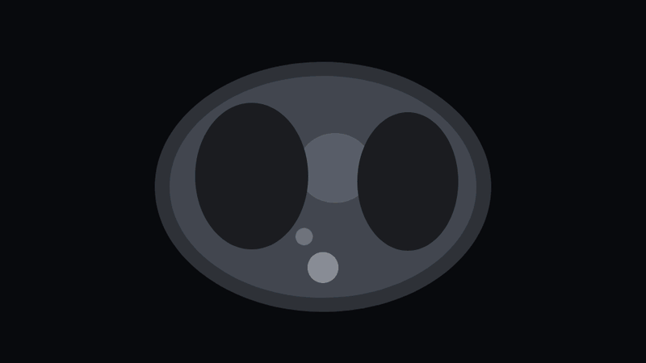
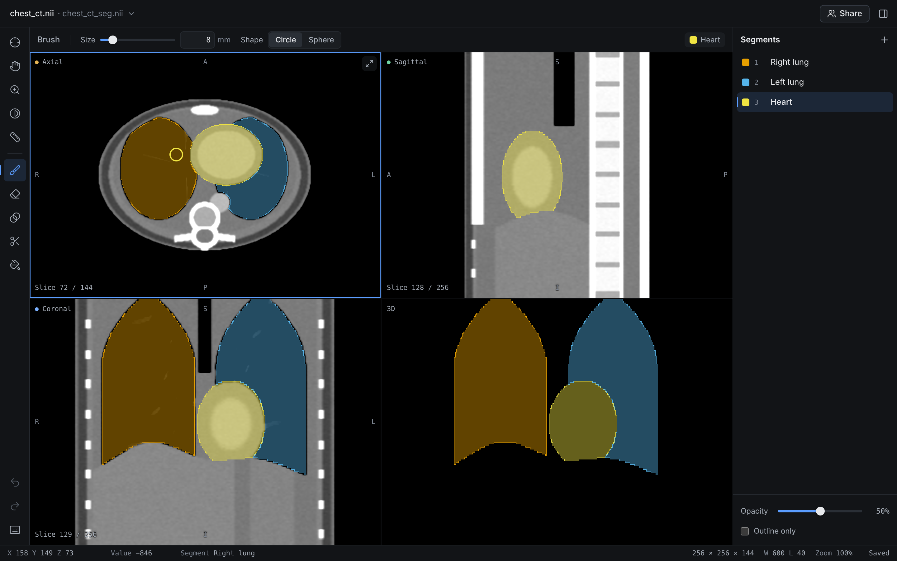

<p align="center">
  
</p>

# W Annotator

W Annotator is a desktop app for macOS, Windows and Linux that opens 3D medical images and lets you edit segmentation masks, alone or with other people in the same mask at once.

<p>
  <a href="https://github.com/ArioMoniri/w-annotator/releases/latest"></a>
  <a href="https://github.com/ArioMoniri/w-annotator/releases/latest"></a>
  <a href="https://github.com/ArioMoniri/w-annotator/releases/latest"></a>
</p>

macOS builds are signed and notarised. The app updates itself from GitHub Releases.



## What it does

- Shows a volume in axial, sagittal and coronal views, with a 3D view of the mask.
- Overlays a mask on an image. The two can be in different formats, such as an MHA image with a `.nii.gz` mask. A mask on another grid is resampled to the image.
- Edits the mask with a brush and an eraser (circle or sphere, size in mm), a threshold brush, scissors and fill.
- Fills the gaps between painted slices, so you only paint every few slices.
- Has crosshair, pan, zoom, a ruler, and window/level with CT presets.
- Manages segments: add, rename, recolour, hide, lock, clear and delete. Mask opacity and an outline-only view.
- Undo and redo.
- Saves the mask as `.nii.gz`, `.nii`, `.mha` or `.nrrd`.

There are no AI features, by design.

## File formats

| Format | Open as image | Open as mask | Save mask |
| --- | --- | --- | --- |
| NIfTI (`.nii`, `.nii.gz`) | yes | yes | yes |
| MetaImage (`.mha`, `.mhd`) | yes | yes | `.mha` |
| NRRD (`.nrrd`, `.seg.nrrd`) | yes | yes | `.nrrd` |
| DICOM series, uncompressed | yes | yes | no |

Not supported yet: compressed DICOM transfer syntaxes and DICOM SEG.

## Working together


A room lets several people edit one mask at the same time. Nobody needs an account, only a display name.

1. Open an image, press **Share** and start a room.
2. Send the invite link to the others.
3. They paste it under *Join a room* and type a name.
4. Someone who joins with nothing open receives the image and the mask.

With the server field left empty, the desktop app hosts the room itself. That works for people on the same network or VPN. To work over the internet, run the relay in [`relay/`](relay/README.md) (a small Rust server, with a Dockerfile) and enter its address when starting the room. The relay forwards messages and stores nothing.

## Shortcuts

| Key | Action | Key | Action |
| --- | --- | --- | --- |
| `B` | Brush | `C` | Crosshair |
| `E` | Eraser | `H` | Pan |
| `T` | Threshold brush | `Z` | Zoom |
| `S` | Scissors | `W` | Window / level |
| `F` | Fill | `R` | Ruler |
| `[` `]` | Brush size | `Space` | Last tool |
| `1`–`9` | Select segment | `N` | New segment |
| `O` | Outline only | `X` | Hide or show the mask |
| `↑` `↓` | Next / previous slice | `M` | Maximise or restore a view |
| `Ctrl+Z` | Undo | `Ctrl+Shift+Z` | Redo |
| `Ctrl+O` | Open image | `Ctrl+Shift+O` | Open mask |
| `Ctrl+S` | Save mask | `Ctrl+\` | Show or hide segments |

On macOS use `Cmd` in place of `Ctrl`. With any tool: scroll changes slice, `Ctrl`+scroll zooms, middle-drag pans, right-drag changes window/level, and double-click maximises a view. The full list is in the app.

## Build from source

You need Node with pnpm, Rust, and the [Tauri v2 prerequisites](https://v2.tauri.app/start/prerequisites/) for your system.

```
pnpm install
pnpm tauri dev           # run the desktop app
pnpm test                # unit tests
pnpm e2e                 # end-to-end tests
cargo test --workspace   # Rust tests, app and relay
```

## Releasing

Pushing a `v*` tag builds the installers and a draft release. The steps and the signing secrets are in [docs/RELEASING.md](docs/RELEASING.md).

## Built on

- [Cornerstone3D](https://www.cornerstonejs.org/), the rendering engine and tool library of the [OHIF Viewer](https://ohif.org/).
- [Tauri](https://tauri.app/) for the desktop shell and the updater.

The animations above are Lottie files. Their sources are `hero.json` and `sync.json` in [`docs/assets`](docs/assets).

W Annotator is not a medical device and must not be used for diagnosis or treatment.
